# 🎬 Movie Ticket Booking Management System

<div align="center">

[](https://www.pega.com/)
[](./LICENSE)
[](https://github.com/Rajkaran-122)
[]()
[]()

**An enterprise-grade, end-to-end Pega Case Management Application automating the complete movie ticket booking lifecycle—from user request and data validation to automated decision-table evaluation, SLA tracking, smart routing, and dynamic mobile E-Ticket generation with QR check-in.**

[Key Features](#-key-features) • [Application Architecture](#-application-architecture) • [User Stories & Evidence](#-user-stories--evidence-us-001--us-010) • [Data Model](#-data-model) • [Decision Logic](#-business-rules--decision-logic) • [Documentation](#-project-documentation) • [Author](#-author--contact)

---

</div>

## 📌 Executive Summary

The **Movie Ticket Booking Management System** is a business-process automation application built on the **Pega Platform**. It streamlines ticket reservations by capturing cinema, showtime, customer, and seat inventory details, evaluating business rules via **Pega Decision Tables**, enforcing compliance with **Service Level Agreements (SLAs)**, and routing cases intelligently across desks.

### 🌟 Highlights
- **Case Type**: `Movie Ticket Request` (Sample Case Prefix: `M-`)
- **Automated Decision Engine**: Zero-touch auto-confirmation for compliant bookings based on ticket counts and cost thresholds.
- **Dynamic Cost Calculation**: Automated Pega activity calculating total price dynamically (`Tickets × Show Price`).
- **SLA & Escalation Protocol**: 2-hour Goal & Deadline with automated escalation email triggers to the Customer Support Manager.
- **Role-Based Smart Routing**: Intelligent case routing across Standard, Premium, Group, Corporate, and Urgent desks.
- **Omnichannel Mobile E-Ticket**: Responsive customer confirmation with dynamic QR code generation for theatre entry.

---

## 🏗️ Application Architecture & Lifecycle

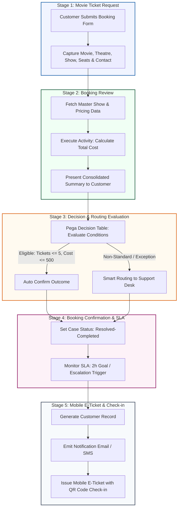

---

## 📸 User Stories & Evidence (US-001 – US-010)

The application has been verified across all 10 core enterprise user stories with runtime execution evidence.

### 🔹 US-001: Submit Movie Ticket Booking Request
* **Goal**: Enable customers to choose movies, theatres, show timings, seat counts, seat preferences, and submit contact information.
* **Result**: Initializes case `M-7` and advances case lifecycle to the review stage.

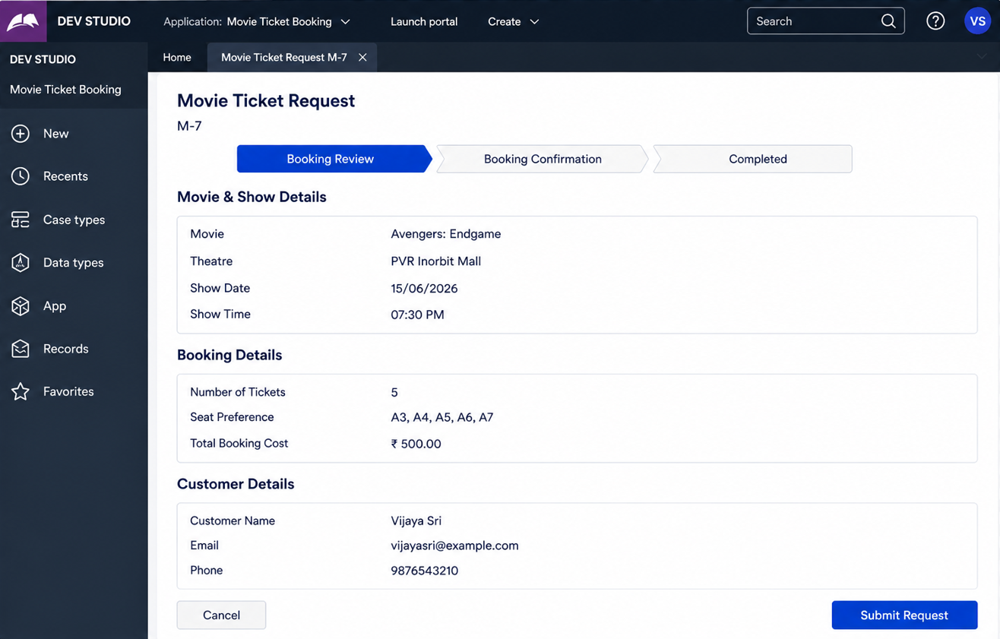

---

### 🔹 US-002: Review Booking Summary
* **Goal**: Display consolidated booking details (Movie, Theatre, Date, Time, Seat Selection, Ticket Count, and calculated Total Cost) before payment/decision.
* **Result**: Clean summary view allowing users to confirm details accurately.

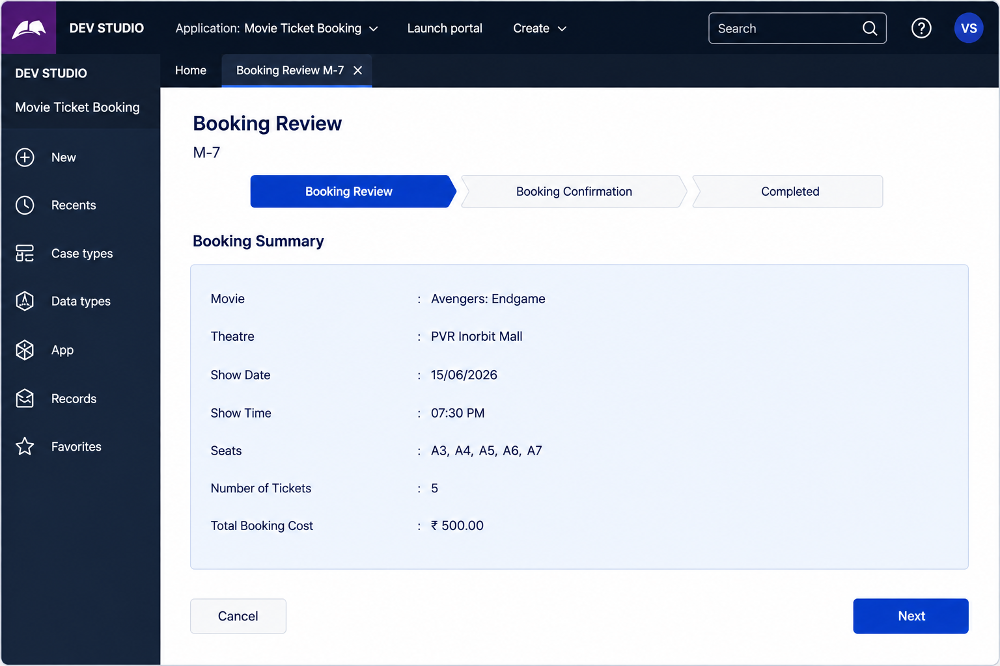

---

### 🔹 US-003: Evaluate Customer Confirmation Decision Table
* **Goal**: Automate booking eligibility evaluation using declarative decision tables (`Number of Tickets`, `Total Booking Cost`, `Notification Sent`).
* **Result**: Instant rule-matched outcome returning `Auto Confirm`.

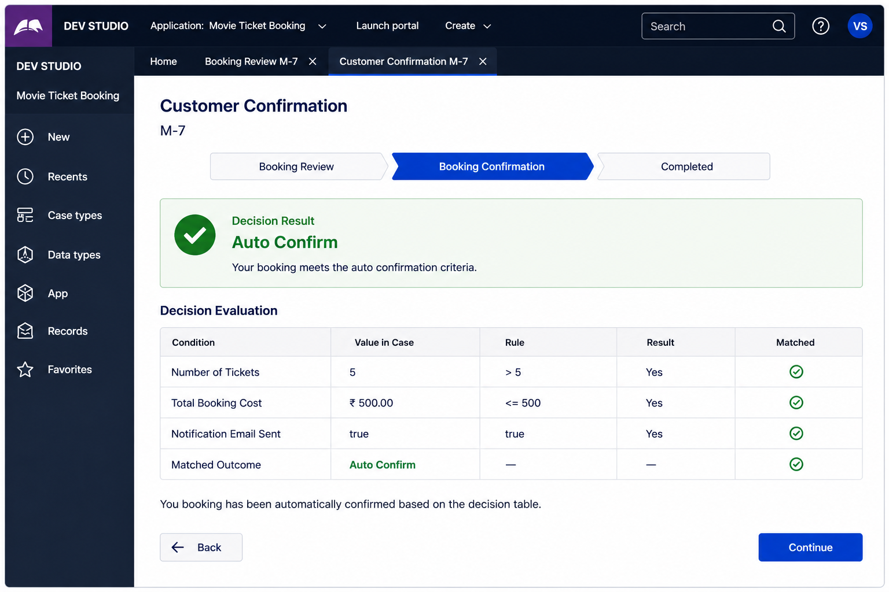

---

### 🔹 US-004: Confirm Booking & Update Work Status
* **Goal**: Finalize booking, transition case status (`pyStatusWork`) to `Resolved-Completed`, and present confirmation details.
* **Result**: Case `M-7` successfully confirmed with timestamp.

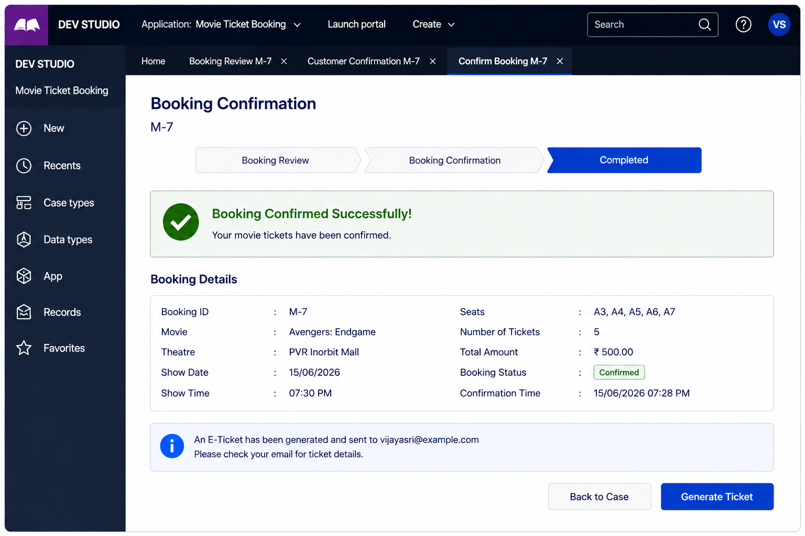

---

### 🔹 US-005: View Confirmed Booking Record & Persistence
* **Goal**: Guarantee auditability and data persistence when case records are revisited.
* **Result**: Verified persistence of transaction data and dispatch of email notifications.

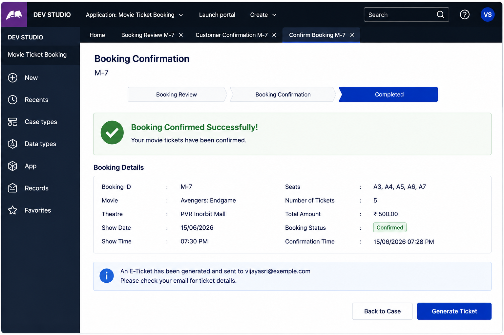

---

### 🔹 US-006: Omnichannel Mobile E-Ticket with QR Code
* **Goal**: Deliver a responsive, mobile-optimized E-Ticket containing booking ID, screen, seat allocation, and a scannable QR code for entry validation.
* **Result**: High-fidelity mobile customer portal with instant check-in readiness.

<div align="center">
  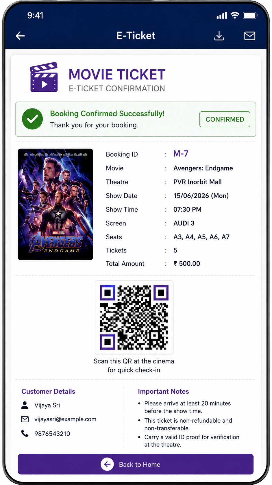
</div>

---

### 🔹 US-007: Maintain Movie, Theatre & Show Data Objects
* **Goal**: Design relational data structures in Dev Studio for `Movie`, `Theatre`, and `Show` master records referenced dynamically by booking cases.
* **Result**: Reusable data layer with primary keys and dynamic lookups.

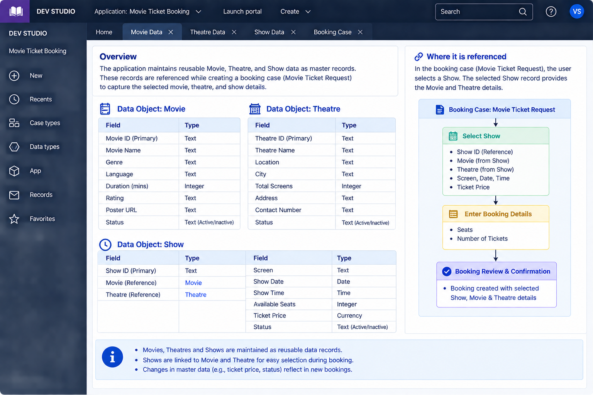

---

### 🔹 US-008: Automated Total Booking Cost Calculation
* **Goal**: Implement a Pega calculation Activity (`Set Total Booking Cost`) executing `Total Cost = Number of Tickets * Ticket Price`.
* **Result**: Real-time automatic computation across all case steps.

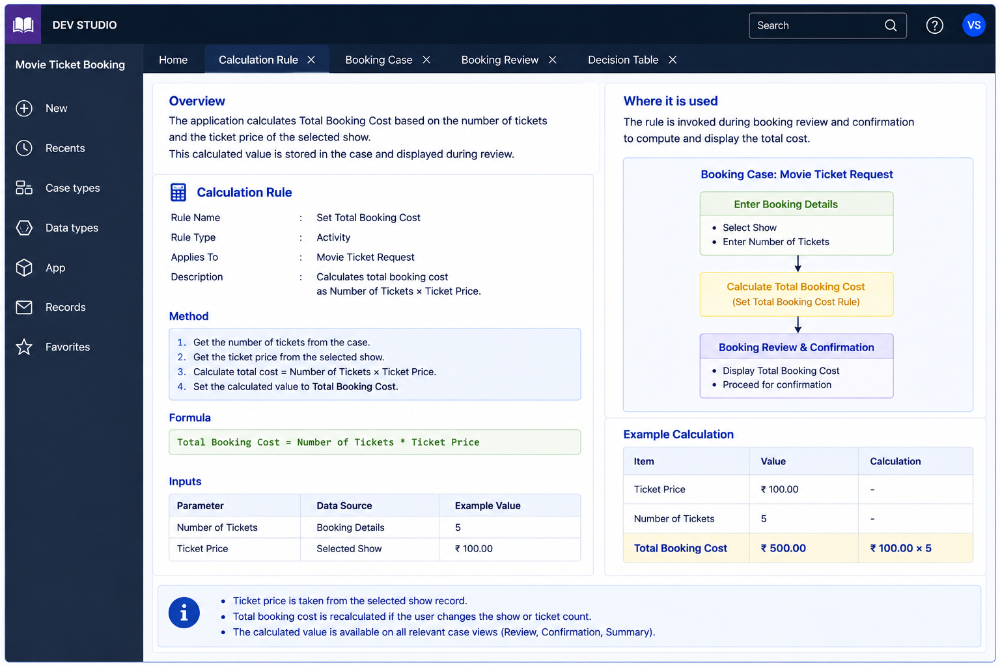

---

### 🔹 US-009: Service Level Agreement (SLA) & Escalation Matrix
* **Goal**: Enforce a 2-hour Goal and 2-hour Deadline SLA with automated escalation notifications to the Customer Support Manager.
* **Result**: SLA monitoring active with real-time countdown (`On Track: 1h 20m remaining`).

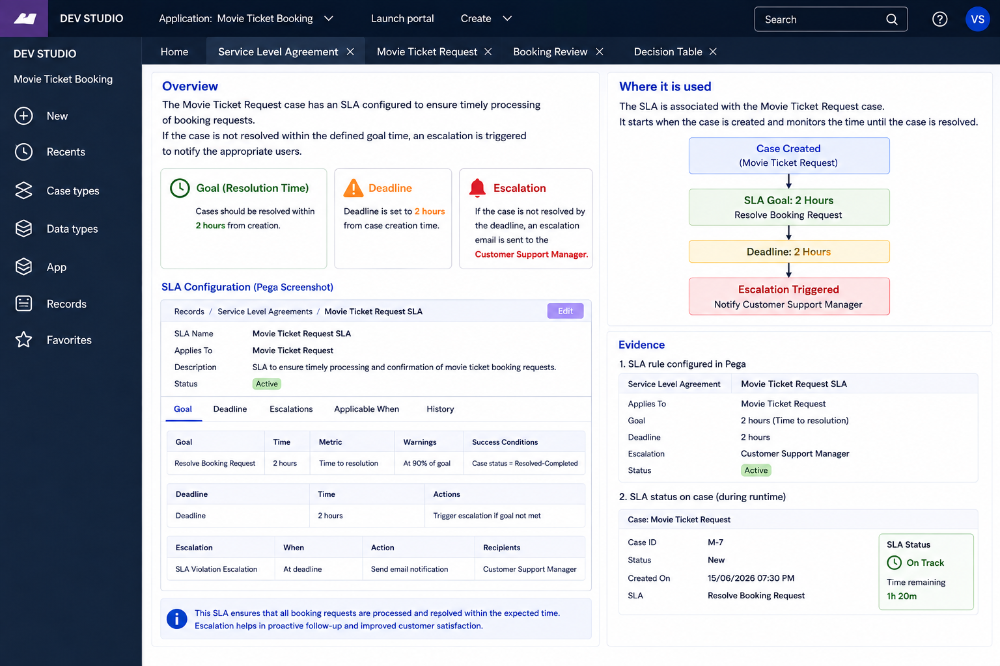

---

### 🔹 US-010: Smart Routing & Notification Matrix
* **Goal**: Route cases to dedicated operational desks (Standard, Premium Desk, Group, Corporate Desk, Urgent Desk) and trigger dual-channel notifications.
* **Result**: Case `M-7` auto-routed to `Premium Desk` with automated customer and assignee alerts.

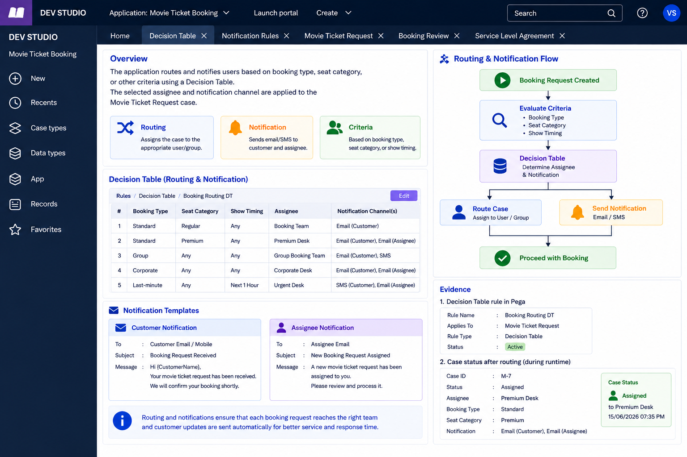

---

## 📊 Data Model & Entity Specifications

The application uses structured Pega Data Types configured in Dev Studio:

```
                  ┌──────────────────────┐
                  │      Data-Movie      │
                  ├──────────────────────┤
                  │ Movie ID (PK)        │
                  │ Movie Name           │
                  │ Genre                │
                  │ Language             │
                  │ Duration (mins)      │
                  │ Rating               │
                  │ Status               │
                  └──────────┬───────────┘
                             │
                             │ references
                             ▼
┌─────────────────────┐   ┌──────────────────────┐   ┌───────────────────────────┐
│    Data-Theatre     │   │      Data-Show       │   │ Work-MovieTicketRequest   │
├─────────────────────┤   ├──────────────────────┤   ├───────────────────────────┤
│ Theatre ID (PK)     │◀──┤ Show ID (PK)         │◀──┤ Case ID (e.g., M-7)       │
│ Theatre Name        │   │ Movie (Reference)    │   │ Show ID (Lookup)          │
│ Location            │   │ Theatre (Reference)  │   │ Customer Name, Email, Ph  │
│ City                │   │ Show Date            │   │ Seats Allocated           │
│ Total Screens       │   │ Show Time            │   │ Number of Tickets         │
│ Contact Number      │   │ Screen               │   │ Total Booking Cost (Calc) │
│ Status              │   │ Ticket Price (Curr)  │   │ pyStatusWork              │
└─────────────────────┘   │ Available Seats      │   │ SLA Goal & Escalation     │
                          │ Status               │   │ Routing Assignee          │
                          └──────────────────────┘   └───────────────────────────┘
```

---

## ⚙️ Business Rules & Decision Logic

### 1. Booking Evaluation Decision Table
| Condition: Tickets | Condition: Total Cost | Condition: Email Sent | Return Action |
| :--- | :--- | :--- | :--- |
| `<= 5` | `<= ₹500.00` | `true` | **`Auto Confirm`** |
| `> 5` | `Any` | `Any` | `Manual Review Desk` |
| `Any` | `> ₹2500.00` | `Any` | `Manager Approval` |
| `Otherwise` | `Otherwise` | `Otherwise` | `Standard Processing` |

### 2. Case Routing Decision Matrix
| Booking Type | Seat Category | Show Timing | Assigned Queue / Desk | Notification Channels |
| :--- | :--- | :--- | :--- | :--- |
| **Standard** | Regular | Any | `Booking Team` | Email (Customer) |
| **Standard** | Premium | Any | `Premium Desk` | Email (Customer), Email (Assignee) |
| **Group** | Any | Any | `Group Booking Team`| Email (Customer), SMS |
| **Corporate** | Any | Any | `Corporate Desk` | Email (Customer), Email (Assignee) |
| **Last-minute** | Any | `< 1 Hour` | `Urgent Desk` | SMS (Customer), Email (Assignee) |

---

## 📚 Project Documentation

For deep technical insights, explore the dedicated documentation modules:

- 📖 [**01. Project Architecture & Data Model**](docs/01-architecture-and-data-model.md)
- 🔄 [**02. Case Lifecycle & Stage Workflows**](docs/02-case-lifecycle-and-workflows.md)
- ⚡ [**03. Decision Tables & Calculation Rules**](docs/03-business-rules-and-decision-tables.md)
- 🎯 [**04. User Story Technical Specifications**](docs/04-user-stories-and-evidence.md)
- 📱 [**05. Omnichannel Mobile E-Ticket Specification**](docs/05-mobile-eticket-spec.md)
- 🧪 [**06. Test Cases & Verification Matrix**](docs/06-testing-and-validation.md)

---

## 🛠️ Verification & Test Matrix

| Test ID | Test Scenario | Input Data | Expected Output | Status |
| :--- | :--- | :--- | :--- | :---: |
| **TC-01** | Valid standard booking creation | 5 Tickets, PVR Inorbit, ₹500 | Case `M-7` generated in `Booking Review` | `PASSED` |
| **TC-02** | Automatic cost calculation | 5 Tickets × ₹100.00 | Total Cost evaluated to ₹500.00 | `PASSED` |
| **TC-03** | Decision table auto-confirmation | Tickets `<= 5`, Cost `<= 500` | Outcome returned as `Auto Confirm` | `PASSED` |
| **TC-04** | SLA attachment & deadline tracking | Case created | 2h Goal & Deadline attached with active countdown | `PASSED` |
| **TC-05** | Smart routing to Premium Desk | Standard type + Premium seats | Case routed to `Premium Desk` queue | `PASSED` |
| **TC-06** | Mobile E-Ticket render | Valid confirmed case | QR check-in and responsive layout visible | `PASSED` |

---

## 👨‍💻 Author & Contact

**Rajkaran Yadav**  
- **GitHub**: [@Rajkaran-122](https://github.com/Rajkaran-122)  
- **Email**: [yadavrajkaran854@gmail.com](mailto:yadavrajkaran854@gmail.com)  
- **Role**: Pega Application Developer & Solution Architect  

---

## 📄 License

This project is licensed under the **MIT License** - see the [LICENSE](LICENSE) file for details.

```text
Copyright (c) 2026 Rajkaran Yadav <yadavrajkaran854@gmail.com>
```
