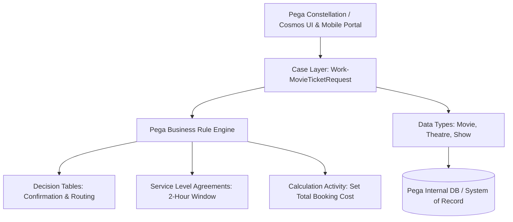

# 🏛️ Pega Architecture & Data Model Specification

## 1. Architectural Overview

The **Movie Ticket Booking Management System** is built on Pega's Model-Driven Architecture following the **Pega Express Delivery** guidelines and **Center-Out Business Architecture**. It leverages Pega Case Management, declarative rules, dynamic data types, and enterprise integrations.



---

## 2. Data Dictionary & Entity Definitions

### 🎬 Data Type: `Data-Movie`
Represents the cinematic entity and catalog details.

| Field Name | Property Name | Data Type | Requirement | Description |
| :--- | :--- | :--- | :--- | :--- |
| **Movie ID** | `MovieID` | Text (Identifier) | **Mandatory (PK)** | Unique identifier for each movie (e.g., `MOV-101`) |
| **Movie Name** | `MovieName` | Text | Mandatory | Full release title of the motion picture |
| **Genre** | `Genre` | Text | Optional | Category (e.g., Action, Sci-Fi, Drama) |
| **Language** | `Language` | Text | Mandatory | Spoken language/dub (e.g., English, Hindi) |
| **Duration** | `DurationMins` | Integer | Mandatory | Runtime in minutes (e.g., 181) |
| **Rating** | `Rating` | Text | Optional | Certification (e.g., PG-13, U/A, R) |
| **Poster URL** | `PosterURL` | Text | Optional | Web address of display poster thumbnail |
| **Status** | `Status` | Text | Mandatory | Lifecycle state (`Active` / `Inactive`) |

---

### 🏢 Data Type: `Data-Theatre`
Represents cinema theatre complexes and infrastructure.

| Field Name | Property Name | Data Type | Requirement | Description |
| :--- | :--- | :--- | :--- | :--- |
| **Theatre ID** | `TheatreID` | Text (Identifier) | **Mandatory (PK)** | Unique theatre complex ID (e.g., `THTR-01`) |
| **Theatre Name** | `TheatreName` | Text | Mandatory | Commercial franchise name (e.g., `PVR Inorbit Mall`) |
| **Location** | `Location` | Text | Mandatory | Area / locality / mall name |
| **City** | `City` | Text | Mandatory | Operational municipality (e.g., Hyderabad) |
| **Total Screens**| `TotalScreens` | Integer | Mandatory | Capacity of screening halls |
| **Address** | `Address` | Text | Optional | Physical street address |
| **Contact No** | `ContactNumber` | Text | Mandatory | Support telephone number |
| **Status** | `Status` | Text | Mandatory | Active / Maintenance status |

---

### 🕒 Data Type: `Data-Show`
Represents scheduled screenings binding movies, theatres, and pricing.

| Field Name | Property Name | Data Type | Requirement | Description |
| :--- | :--- | :--- | :--- | :--- |
| **Show ID** | `ShowID` | Text (Identifier) | **Mandatory (PK)** | Scheduled slot identifier (e.g., `SHW-889`) |
| **Movie Ref** | `MovieRef` | Reference (`Data-Movie`) | Mandatory (FK) | Reference link to parent Movie object |
| **Theatre Ref** | `TheatreRef` | Reference (`Data-Theatre`)| Mandatory (FK) | Reference link to parent Theatre object |
| **Show Date** | `ShowDate` | Date | Mandatory | Calendar screening date (`DD/MM/YYYY`) |
| **Show Time** | `ShowTime` | TimeOfDay | Mandatory | Screening start time (e.g., `07:30 PM`) |
| **Screen** | `Screen` | Text | Mandatory | Screen number or audi name (e.g., `Audi 3`) |
| **Available Seats** | `AvailableSeats` | Integer | Mandatory | Remaining inventory count |
| **Ticket Price**| `TicketPrice` | Decimal / Currency | Mandatory | Unit admission cost (e.g., `₹100.00`) |
| **Status** | `Status` | Text | Mandatory | Booking availability state (`Open`/`Sold Out`) |

---

### 📋 Case Type: `Work-MovieTicketRequest`
Primary work object encapsulating the customer booking transaction.

| Property Name | Data Type | Description |
| :--- | :--- | :--- |
| `pyID` | Text | Unique Case Identifier (e.g., `M-7`) |
| `CustomerName` | Text | Customer full legal name |
| `CustomerEmail`| Text | Notification recipient email |
| `CustomerPhone`| Text | SMS recipient phone number |
| `SelectedShow` | Single Page (`Data-Show`) | Selected show snapshot and relational properties |
| `NumberOfTickets` | Integer | Quantity of seats requested |
| `SeatPreference` | Text | Allocated seat codes (e.g., `A3, A4, A5, A6, A7`) |
| `TotalBookingCost` | Currency | Calculated transaction total |
| `pyStatusWork` | Text | Case status (`New`, `Pending-Review`, `Resolved-Completed`) |
| `SLAStatus` | Text | SLA tracking property (`On Track`, `Violated`) |
| `AssignedDesk` | Text | Target operational routing group |

---

## 3. Class Hierarchy

```text
@baseclass
  ├── Work-
  │    └── Work-Cover-
  │         └── NIP-MovieTicketBooking-Work
  │              └── NIP-MovieTicketBooking-Work-MovieTicketRequest
  └── Data-
       └── NIP-MovieTicketBooking-Data
            ├── NIP-MovieTicketBooking-Data-Movie
            ├── NIP-MovieTicketBooking-Data-Theatre
            └── NIP-MovieTicketBooking-Data-Show
```
