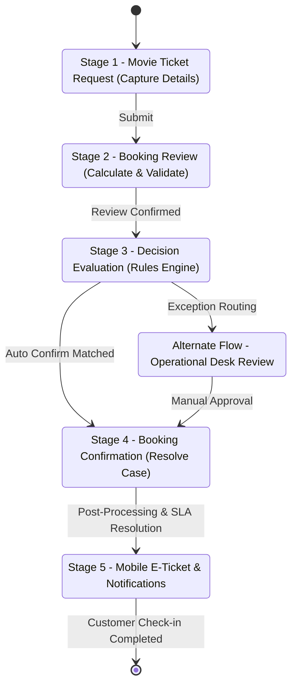

# 🔄 Case Lifecycle & Stage Workflow Specification

## 1. Multi-Stage Case Design

The `Movie Ticket Request` case type is designed in **Pega App Studio & Dev Studio** with a 5-stage structured lifecycle.

---

## 2. Stage Breakdown

### 📍 Stage 1: Movie Ticket Request (Data Intake)
* **Primary Actor**: Customer / Box-Office Operator
* **Steps**:
  1. **Select Movie & Theatre**: Dropdowns filtered from `Data-Movie` and `Data-Theatre`.
  2. **Select Show & Showtime**: Fetches scheduled records from `Data-Show`.
  3. **Seat Selection**: Interactive grid or preference entry (`A3, A4, A5...`).
  4. **Customer Information**: Captures Name, Email, Phone Number.
* **Validation**:
  - `NumberOfTickets > 0`
  - Valid regex email format
  - 10-digit mobile number format
  - Show time in the future

---

### 📍 Stage 2: Booking Review (Data Consolidation)
* **Primary Actor**: System / Customer Review
* **Steps**:
  1. **Compute Pricing**: Invokes Pega Activity `Set Total Booking Cost`.
  2. **Display Read-Only Summary**: Renders Movie Title, Hall, Timing, Seat Labels, Quantity, and Calculated Price (`₹500.00`).
  3. **Customer Verification**: Confirmation action allowing proceeding or back-navigation.

---

### 📍 Stage 3: Customer Confirmation (Decision Evaluation)
* **Primary Actor**: Pega Business Rules Engine (BRE)
* **Steps**:
  1. **Decision Table Evaluation**: Reads inputs (`NumberOfTickets`, `TotalBookingCost`, `NotificationEmailSent`).
  2. **Execution Outcome**:
     - *Eligible Path*: Directly triggers `Auto Confirm`.
     - *High Quantity / Value Path*: Routes to `Premium Desk` / `Manager Review`.

---

### 📍 Stage 4: Booking Confirmation (Case Resolution)
* **Primary Actor**: System
* **Steps**:
  1. **Status Transition**: Updates `pyStatusWork` to `Resolved-Completed`.
  2. **SLA Milestone Evaluation**: Marks SLA Goal as met within the allocated 2-hour window.
  3. **Record Finalization**: Persists final transaction snapshot.

---

### 📍 Stage 5: Mobile E-Ticket & Omnichannel Delivery
* **Primary Actor**: Customer / Theatre Scanner
* **Steps**:
  1. **Email / SMS Dispatch**: Sends booking notification with ticket reference.
  2. **Mobile Portal Render**: Generates responsive ticket with unique alphanumeric Case ID (`M-7`).
  3. **QR Check-in Generation**: Encodes ticket metadata into scannable payload for gate validation.
